# MSP

A small remote monitoring and management platform for an IT provider: one Go server
binary (SQLite inside, dashboard embedded), one desktop agent binary for Linux and
Windows, and a Kotlin agent for Android. Agents only ever connect outbound; commands
ride on the heartbeat channel.

- `docs/PROTOCOL.md` is the normative wire contract (agent and dashboard APIs, CLI).
- `docs/ARCHITECTURE.md` is the component overview and the package dependency rules.
- `docs/PLAN.md`, `docs/WORKPACKAGES.md`, `docs/DECISIONS.md` are the build plan.
- `docs/OPS.md` and `docs/SECURITY.md` cover deployment and the threat model.
- `docs/GUIDE.md` is the technician's guide; `docs/RUSTDESK-BRANDING.md` the not-yet-built
  branded RustDesk client (remote desktop phase B).

## Screenshots

Every image was taken from a live run in the build container (real server, real Linux agent) and
carries its label in the top banner. Desktop width shown here; phone-width versions and the full
set of 38 are in [`docs/screenshots/`](docs/screenshots/README.md). Diagrams are in
[`docs/diagrams/`](docs/diagrams/README.md).

**System map.** Agents connect outbound only; one server holds the APIs, queue, alerts, SQLite and the dashboard.

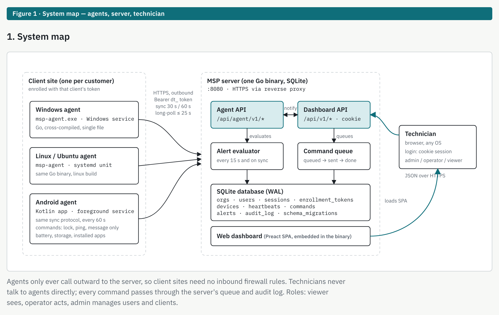

**Fleet.** Every device across all clients with online status, OS, last seen, CPU, memory, disk and open alerts.

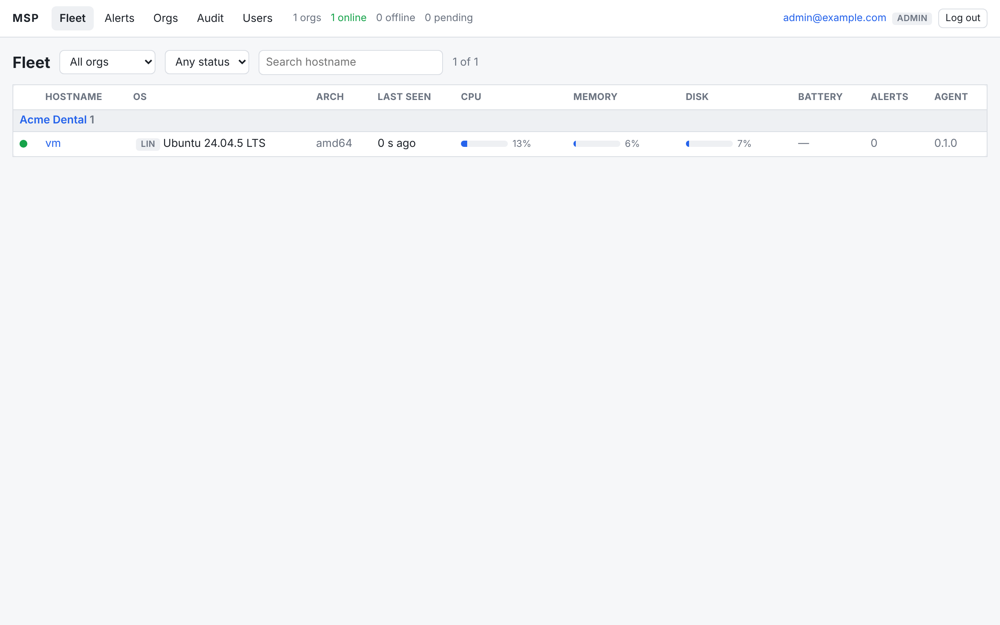

**Client page.** Enrollment token shown once, with the Linux, Windows and Android install one-liners.

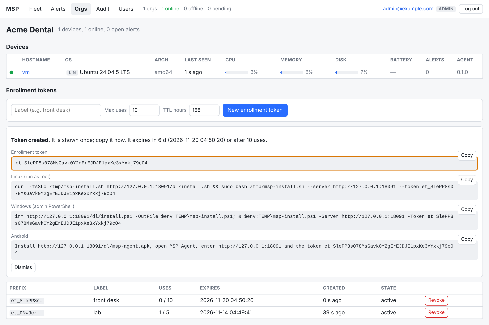

**Device page.** Status, metrics, facts, disks, actions (Lock, Ping, Message) and the run console.

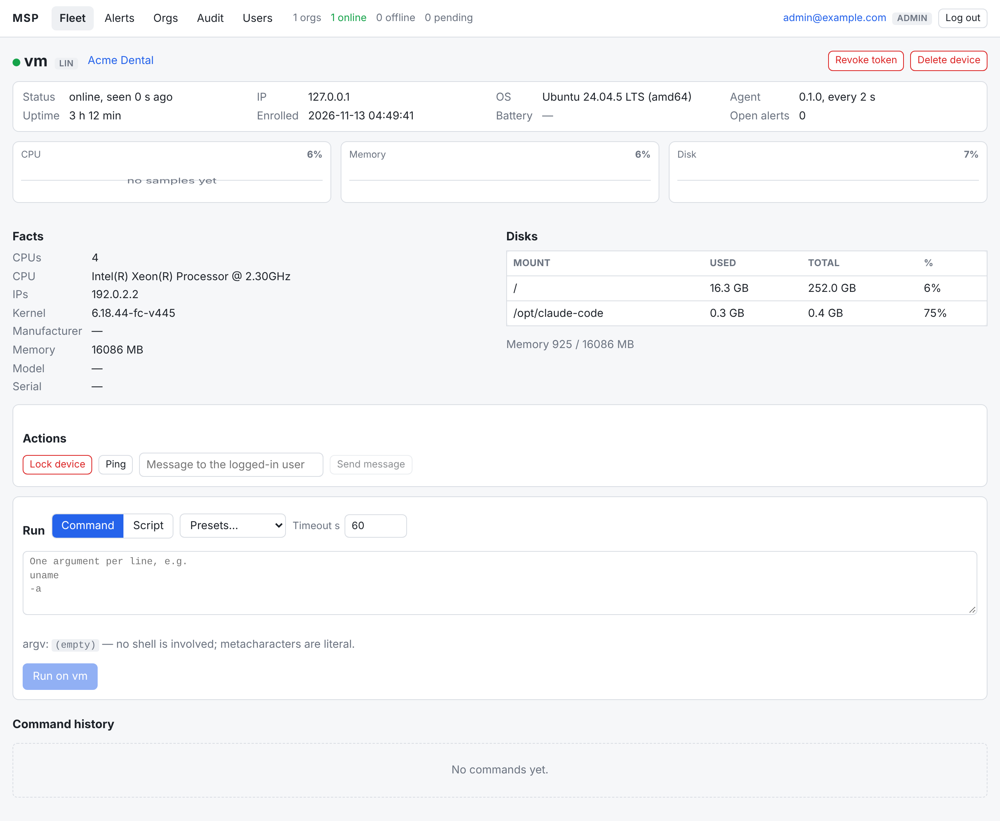

**Remote command.** `uname -a` queued from the dashboard, delivered on the agent's sync, output and exit code shown.

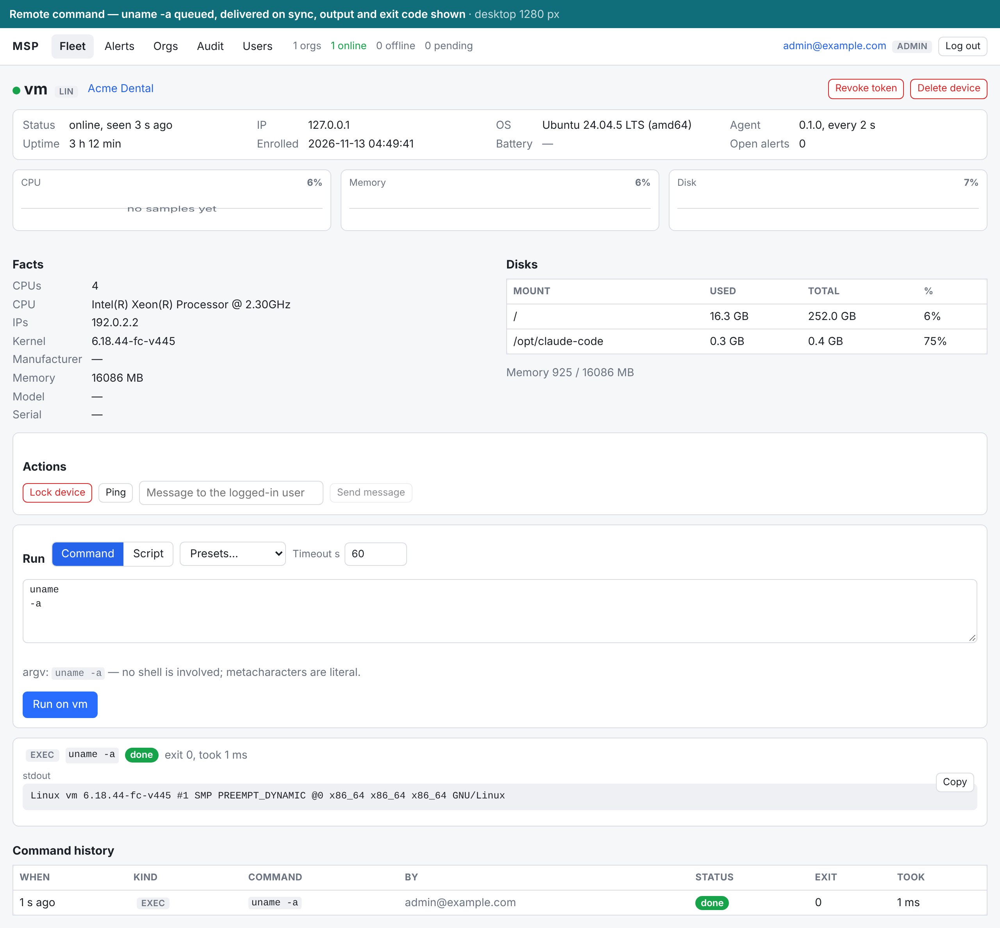

**Remote lock.** Delivered, executed and audited; the headless build host reports "no interactive session".

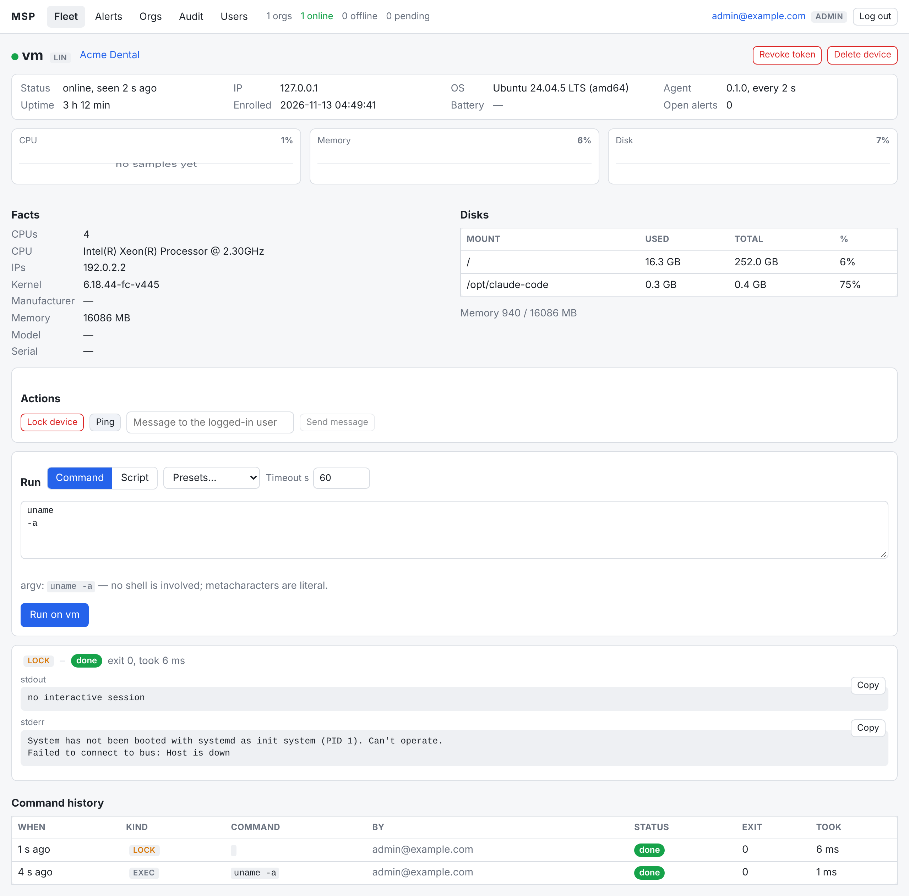

**Presets.** The command library loaded from `presets.json`; a pick fills the console and the timeout.

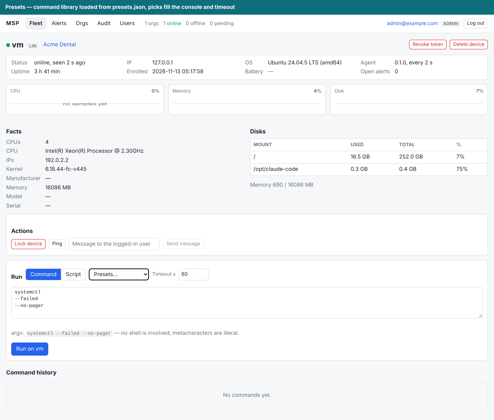

**Remote desktop.** RustDesk ID reported by the agent; Connect opens the technician's RustDesk client through our own relay.

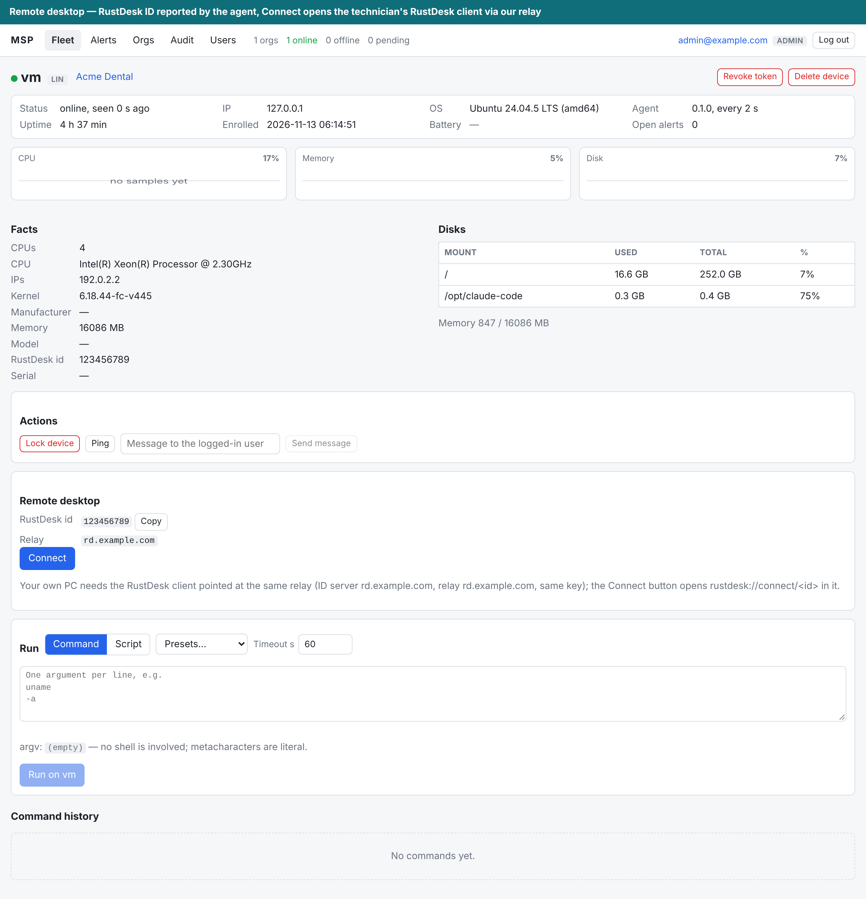

**Android installed apps.** Inventory reported by the Android agent, searchable, system apps hidden by default.

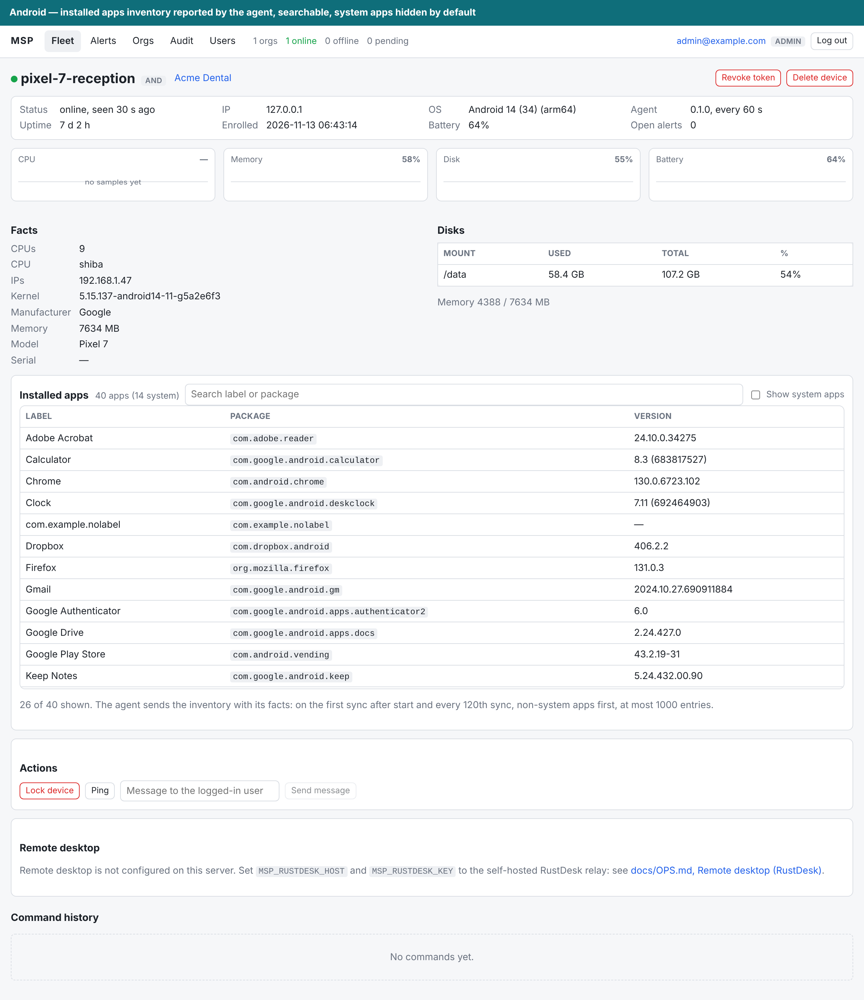

**Alerts.** The agent was stopped; the evaluator opened an offline alert, then it was acknowledged.

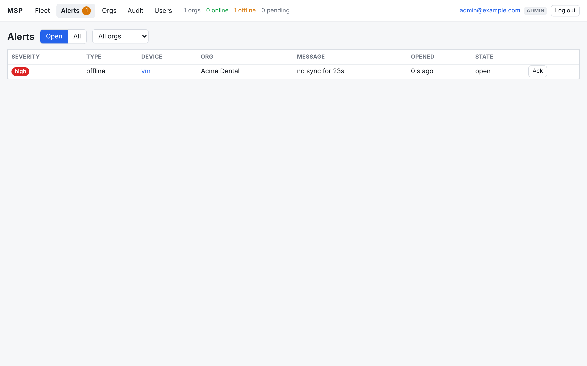

**Audit log.** Login, token, enrollment, command, lock and remote desktop connect, with actor and IP.

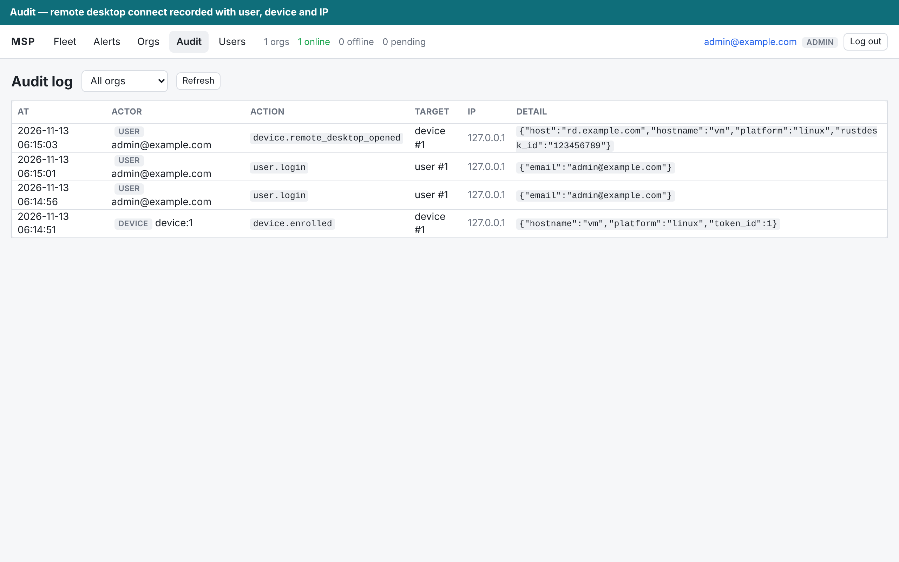

**Phone width.** No horizontal scroll on any page.

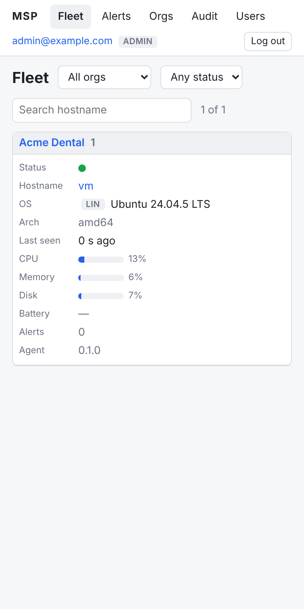

## Quickstart (Linux, one machine)

Requirements: Go 1.24. Node 22 is only needed for `make web`; the Go build and all
Go tests work without it because `web/dist/index.html` is committed.

```sh
make build                                   # bin/msp-server and bin/msp-agent

export MSP_DB=./msp.db MSP_LISTEN=127.0.0.1:8080 MSP_BASE_URL=http://127.0.0.1:8080
echo 'admin-pass-123' | bin/msp-server user add --email admin@example.com --role admin --password-stdin
ORG=$(bin/msp-server org add --name "Acme Dental")                       # prints the org id
ET=$(bin/msp-server token new --org "$ORG" --label lab --max-uses 5 --ttl 24h)   # prints et_...

bin/msp-server serve &                       # http://127.0.0.1:8080

# enroll this machine as a Linux device (plain http is allowed only on loopback)
bin/msp-agent enroll --server http://127.0.0.1:8080 --token "$ET" --config /tmp/agent.json --interval 30
bin/msp-agent run --config /tmp/agent.json &
```

Open http://127.0.0.1:8080 and log in as `admin@example.com`. The Fleet page shows the
host online under "Acme Dental"; open it and run `uname -a` from the console (after
`make web`; before that the page says "Dashboard bundle not built").

The same round trip from the command line:

```sh
H='X-Requested-With: msp'; J='Content-Type: application/json'; B=http://127.0.0.1:8080
curl -sf -c jar -H "$H" -H "$J" -d '{"email":"admin@example.com","password":"admin-pass-123"}' $B/api/v1/login
DEV=$(curl -sf -b jar "$B/api/v1/devices" | jq -r '.devices[0].id')
curl -sf -b jar -H "$H" -H "$J" -d '{"kind":"exec","argv":["uname","-a"],"timeout_s":30}' $B/api/v1/devices/$DEV/commands
curl -sf -b jar $B/api/v1/devices/$DEV/commands | jq '.commands[0] | {status, exit_code, stdout}'
```

Real installs use the one-liners shown next to each enrollment token in the dashboard
(`install.sh`, `install.ps1`, the APK), served from `MSP_AGENT_DIR` at `/dl/`.
Production runs behind TLS: see `docs/OPS.md`.

Server settings are environment variables (a flag of the same name overrides each; the
full table is in `docs/OPS.md` section 1):

| variable | default | meaning |
|---|---|---|
| `MSP_DB` | `./msp.db` | SQLite file |
| `MSP_LISTEN` | `:8080` | listen address |
| `MSP_BASE_URL` | `""` | public URL printed into install one-liners |
| `MSP_TLS_CERT` / `MSP_TLS_KEY` | unset | serve TLS directly when both are set |
| `MSP_SECURE_COOKIES` / `MSP_TRUST_PROXY` | `0` | behind your own TLS proxy: `1` and `1` |
| `MSP_AGENT_DIR` | `""` | directory served at `/dl/` |
| `MSP_RETENTION_DAYS` | `7` | heartbeat retention |
| `MSP_PRESETS` | `""` | JSON command preset library for the device console (template: `deploy/presets.example.json`); unset = builtin set; edits apply live on the server (reload the dashboard to see them) |
| `MSP_RUSTDESK_HOST` / `MSP_RUSTDESK_KEY` | `""` | remote desktop: your self-hosted RustDesk relay (bare hostname or IP; hbbs/hbbr in the compose profile `rustdesk`) and its public key (`id_ed25519.pub`); both or neither (`docs/OPS.md` section 10) |

## Make targets

| target          | what it does                                                                 |
|-----------------|------------------------------------------------------------------------------|
| `build`         | `bin/msp-server`, `bin/msp-agent` for this host (static, CGO off)            |
| `test`          | `go vet ./...` and `go test ./...` including the in-process e2e              |
| `race`          | race detector on server, agent and e2e packages                              |
| `web`           | `npm ci`, tests, typecheck, esbuild bundle, then rebuild the server          |
| `agents`        | cross-compile matrix into `dist/` + `SHA256SUMS` + install scripts (`scripts/build-agents.sh --sums-only` re-sums `MSP_AGENT_DIR` after dropping the RustDesk client installers in) |
| `android`       | debug APK (lab only, never published) via the system Gradle (`ANDROID_HOME` defaults to /opt/android-sdk)|
| `android-release` | the publishable signed APK; needs `MSP_ANDROID_KEYSTORE` (docs/OPS.md section 3) |
| `android-test`  | JVM protocol tests against `internal/protocol/fixtures`                      |
| `e2e`           | `scripts/e2e.sh`: real binaries, exit 0 and `E2E OK` are the verdict         |
| `compose-check` | `docker compose config` and `bash -n` on the scripts (no daemon needed)      |
| `docker`        | server image from `deploy/Dockerfile` (needs a daemon)                       |
| `clean`         | removes `bin/`, `dist/` and the web bundle                                   |

## Repository layout

```
cmd/msp-server, cmd/msp-agent      CLIs
internal/protocol                  wire types, constants, validation, JSON fixtures (shared contract)
internal/store                     SQLite schema, migrations, typed data access
internal/server                    HTTP server: agent API, dashboard API, alerts, jobs
internal/agent                     desktop agent: metrics, sync loop, command runner, service
internal/e2e                       in-process end-to-end test
web/                               Preact + TypeScript dashboard, embedded via web/embed.go
android/                           Kotlin agent (foreground service)
deploy/                            Dockerfile, compose, Caddyfile, systemd unit, installers
scripts/                           e2e.sh, build-agents.sh
```

## Go module notes

`go.mod` requires exactly three third-party modules: `modernc.org/sqlite` (store),
`golang.org/x/crypto` (bcrypt, server) and `golang.org/x/sys` (agent). They are pinned
to the newest releases whose `go` directive is 1.24 (`modernc.org/sqlite v1.45.0`,
`golang.org/x/crypto v0.48.0`, `golang.org/x/sys v0.41.0`); the later releases named in
`docs/PLAN.md` require Go 1.26 and would force a toolchain switch in the container, the
`golang:1.24-alpine` image and CI. `go.sum` already covers the full graph for linux,
windows and android builds. Do not run `go mod tidy` until `internal/store`,
`internal/server` and `internal/agent` exist, or it drops the requires.
