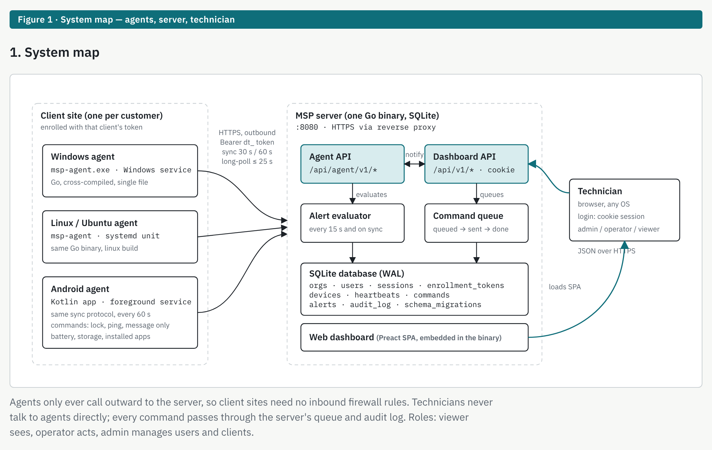
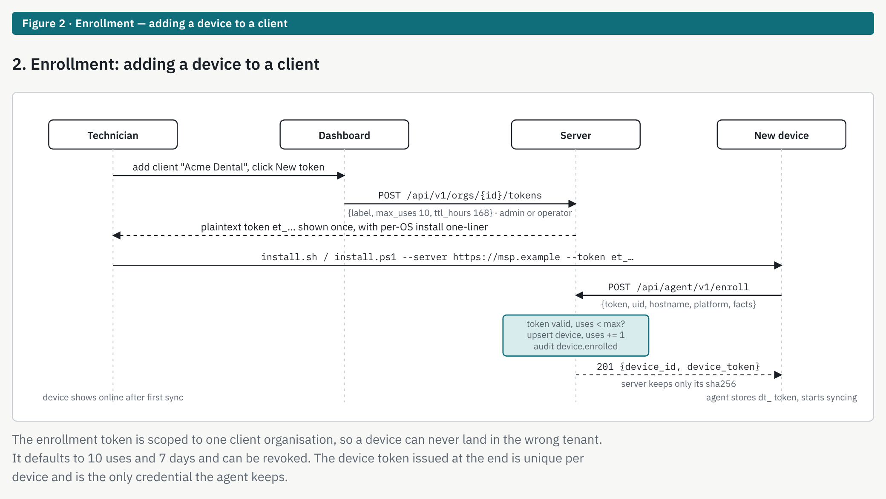
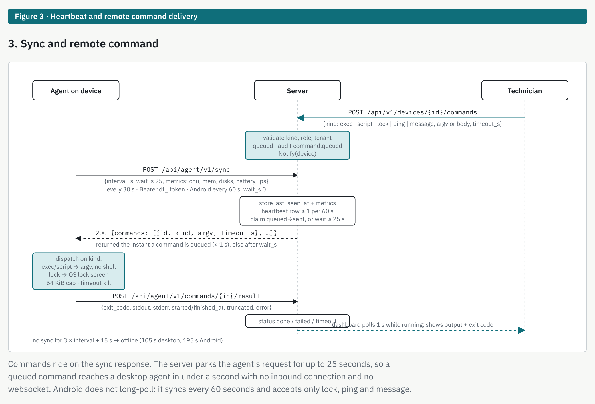
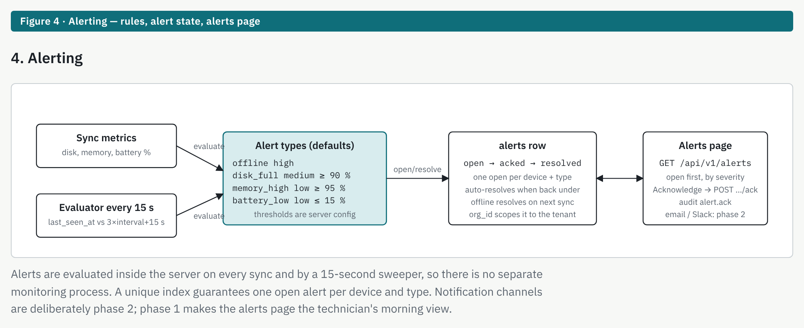
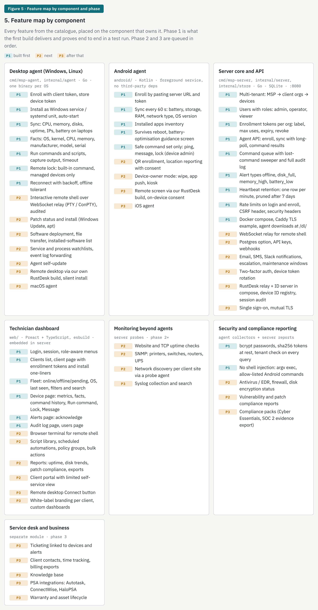
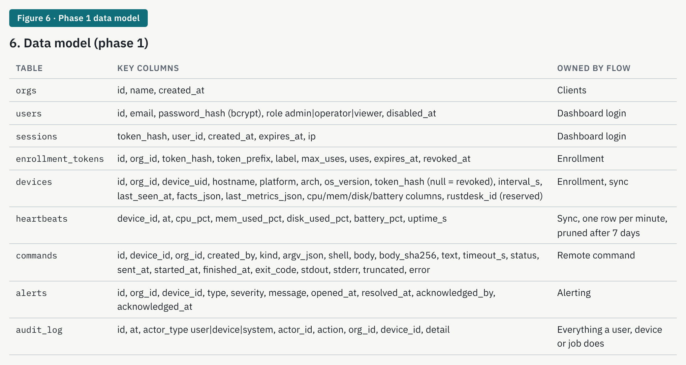

# Diagrams

Rendered from the platform map (docs/PLAN.md is the source of truth for endpoints, intervals and tables). Each image carries its label in the top banner.

| Image | Shows |
|---|---|
|  | **Figure 1 · System map.** Windows, Linux and Android agents call the one Go server outbound over HTTPS; the server holds the agent API, dashboard API, alert evaluator, command queue, SQLite and the embedded dashboard; technicians use a browser with admin / operator / viewer roles. |
|  | **Figure 2 · Enrollment.** Technician creates a client and an org-scoped enrollment token, installs the agent with it, the agent calls `/api/agent/v1/enroll`, and receives its own device token. |
|  | **Figure 3 · Sync and remote command.** The agent posts `/api/agent/v1/sync` every 30 s (Android 60 s); the server parks the request up to 25 s and returns queued commands (exec, script, lock, ping, message); results come back on `/api/agent/v1/commands/{id}/result`. |
|  | **Figure 4 · Alerting.** Sync metrics and a 15 s evaluator feed the four alert types (offline, disk_full, memory_high, battery_low); one open alert per device and type; acknowledged on the alerts page; auto-resolve when back under threshold. |
|  | **Figure 5 · Feature map.** Every feature by owning component, tagged P1 (built first), P2, P3. |
|  | **Figure 6 · Data model.** The ten phase 1 tables and the flow each one serves. |

Application screenshots (login, fleet, device page, commands, lock, alerts, audit) are added to `docs/screenshots/` as each feature is verified, with the same labelled format.
